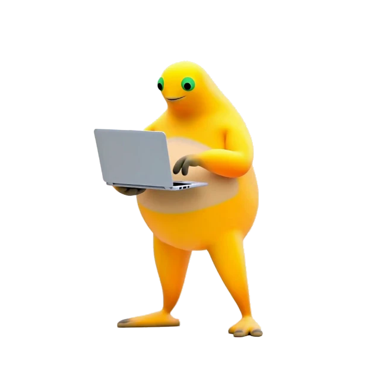
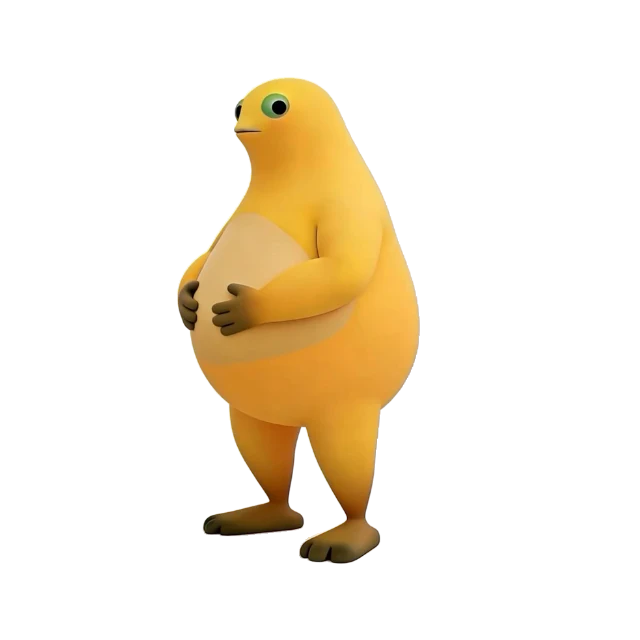

# 奶蛙 on Desk · Naifrog on Desk

**让奶蛙陪你写代码。**

奶蛙 on Desk 是一款会跟随 AI 编码状态做出反应的桌面宠物。你发出任务，它托腮思考；工具开始运行，它忙着打字、戴耳机或施工；任务完成，它用一阵大笑告诉你。没事做的时候，它会偷偷瞥你一眼、吹泡泡，或者趴下来睡觉。

[下载安装](https://github.com/Noboru2UTokyo/naifrog-on-desk/releases/latest) · [接入编码工具](docs/guides/setup-guide.md) · [反馈问题](https://github.com/Noboru2UTokyo/naifrog-on-desk/issues)

| 待机 · 惊鸿一瞥 | 工作 · 敲键盘 | 完成 · 放声大笑 |
| :---: | :---: | :---: |
|  |  |  |

## 桌面上的奶蛙

- **跟着工作状态动起来。** 通过 Claude Code、Codex、Cursor 等工具的集成，响应思考、工具执行、子代理和任务完成事件。
- **越忙，动作越不一样。** 一个工作会话时打字，两个时戴耳机，三个及以上时施工。同一状态下持续循环，切换时自然过渡。
- **有自己的小动作。** 保留「惊鸿一瞥」和 12 秒大笑，还有托腮、吹泡泡，以及趴下、睡觉、撑起醒来的连续动作。
- **需要你时会提醒。** 支持的工具发起权限请求时显示气泡；完成和确认提示配上奶蛙笑声音效。
- **安装后就是奶蛙。** 动画和声音全部内置，界面采用奶黄色与绿色点缀，也可以在设置中切换其他主题。

## 安装

目前提供 **macOS Apple Silicon（M 系列芯片）** 安装包。

1. 前往 [最新版本](https://github.com/Noboru2UTokyo/naifrog-on-desk/releases/latest)，下载以 `arm64.dmg` 结尾的文件。
2. 打开 DMG，将 **Naifrog on Desk.app** 拖入 **Applications**，然后启动。
3. 在 **Settings → Agents** 中配置你使用的编码工具，即可让奶蛙跟随任务状态活动。部分集成需要 Node.js 或宿主工具的 hook 审核，详见[接入指南](docs/guides/setup-guide.md)。

已安装原版 Clawd 的用户，也可以下载 Release 中的 **Naifrog 独立主题 ZIP**，从主题设置导入。

> 安装包尚未做 Apple 公证。首次打开如被 macOS 拦截，请核对下载来源，并按系统「隐私与安全性」提示处理。更新前退出旧版；原版 Clawd 与奶蛙版请只运行一个。手动替换应用会保留已有设置。

## 动作如何触发

| 编码状态 | 奶蛙的反应 |
| --- | --- |
| 提交任务、思考中 | 托腮抱臂 |
| 1 个工作会话 | 打字 |
| 2 个工作会话 | 戴耳机 |
| 3 个及以上工作会话 | 施工 |
| 子代理工作 | 戴耳机 |
| 任务完成 | 大笑 12 秒 |
| 等待权限确认 | 权限气泡与短笑声 |
| 空闲 | 惊鸿一瞥，偶尔吹泡泡 |
| 进入睡眠 | 趴下、呼吸打盹，唤醒后撑起身体 |

不同编码工具支持的事件有所不同，具体见[状态映射说明](docs/guides/state-mapping.md)。

## 制作与致谢

**[Noboru2UTokyo](https://github.com/Noboru2UTokyo) 发起、主导设计并维护奶蛙版**，负责奶蛙主题、角色形象统一、动画动作与循环设计、素材适配、界面风格及应用发行。

本项目基于 **[Clawd on Desk](https://github.com/rullerzhou-afk/clawd-on-desk)**，沿用 rullerzhou-afk（Ruller_Lulu / 鹿鹿）及社区贡献者开发的桌宠框架和编码工具集成。完整上游介绍与贡献者名单见 [README.upstream.md](README.upstream.md)。

代码采用 [AGPL-3.0-only](LICENSE)。奶蛙原角色及原始素材归各自权利人所有，详细归属见 [NOTICE.md](NOTICE.md)。开发、构建和维护说明见 [NAIFROG.md](NAIFROG.md)。
